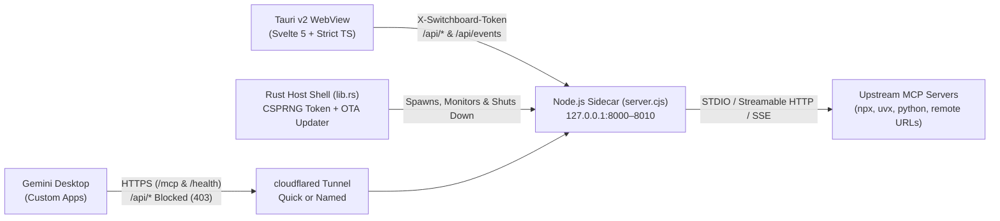

<div align="center">
  
  <h1>MCP Switchboard</h1>
  <p>
    <strong>Setup once. Connect any IDE or AI agent. Zero idle token bloat.</strong><br />
    Universal desktop MCP switchboard (<strong>Streamable HTTP</strong>, <strong>Legacy SSE</strong>, <strong>STDIO bridge</strong> &amp; <strong>Cloudflare Tunnel</strong>) for <strong>Claude Code</strong>, <strong>Cursor</strong>, <strong>VS Code Copilot</strong>, <strong>Windsurf</strong>, <strong>Zed</strong>, <strong>Claude Desktop</strong>, <strong>Gemini</strong>, and <strong>ChatGPT</strong>.
  </p>

  <p>
    <a href="https://github.com/Sury2797/MCP-SWITCHBOARD/releases">
      
    </a>
    <a href="https://github.com/Sury2797/MCP-SWITCHBOARD/actions/workflows/release.yml">
      
    </a>
    
    
    
    
  </p>

  <p>
    <a href="#windows">
      
    </a>
    <a href="#macos">
      
    </a>
    <a href="#linux">
      
    </a>
  </p>

  <p>
    <a href="#quick-start">Quick Start</a> &nbsp;·&nbsp;
    <a href="#downloads">Downloads</a> &nbsp;·&nbsp;
    <a href="#architecture">Architecture</a> &nbsp;·&nbsp;
    <a href="#configuration--examples">Configuration</a> &nbsp;·&nbsp;
    <a href="#security-model">Security Model</a> &nbsp;·&nbsp;
    <a href="#development--ci">Development &amp; CI</a>
  </p>
</div>

---

## Why MCP Switchboard?

| Challenge | With MCP Switchboard |
| :--- | :--- |
| **Context window bloat** from 30–100+ unused MCP schemas | Toggle servers per task — disabling a server kills its process (`0 MB RAM`) and removes its schemas (`0 input tokens`) while firing `notifications/tools/list_changed`. |
| **Local STDIO servers vs. Gemini Desktop HTTPS apps** | Aggregates local `stdio` (`npx`, `uvx`, `python`) and remote `streamableHttp` / `sse` tools behind one `/mcp` URL plus an optional one-click `cloudflared` HTTPS tunnel. |
| **Insecure local HTTP bridges & orphaned child processes** | Rust enforces a per-launch 256-bit OS-CSPRNG token on `/api/*`, blocks tunnel/proxy traffic with `403`, and terminates entire process trees on exit. |

---

## Architecture



<details>
<summary><strong>How Dynamic Multiplexing, Namespacing &amp; Token Metering Work</strong></summary>

1. **Tool Namespacing:** Enabled upstream tools are exposed cleanly as `<serverName>__<toolName>` (via `sanitizePrefix`) and routed dynamically back to the owning MCP client session on `tools/call`.
2. **Live Capability Sync:** Whenever a server connects, stops, or encounters an error, the sidecar broadcasts `notifications/tools/list_changed` to every connected `/mcp` client session and pushes live SSE state updates (`GET /api/events`) to the desktop UI.
3. **Token Budget Meter:** Estimates active input token overhead (`Math.ceil(JSON.stringify(tools).length / 4)`) per server and in total across live tiers: **Lean** (`< 3,000`), **Moderate** (`3,000–10,000`), and **High** (`> 10,000`).
4. **Native Desktop Craft:** Built on a locked non-bouncing quiet-graphite viewport with BoardUI-inspired primitives (`Button`, `Switch`, `SegmentedControl`, `CustomSelect`), React Bits `CountUp` and `spotlight` catchlight, live log viewer, tool schema inspector, and `prefers-reduced-motion` support.

</details>

---

## Quick Start

### Prerequisites

| Tool | Purpose | Install Command |
| :--- | :--- | :--- |
| **Node.js 20+** | Required to run the bundled sidecar engine (`server.cjs`) and JS MCP servers | Windows: `winget install OpenJS.NodeJS.LTS` · macOS: `brew install node` · Linux: NodeSource / distro LTS |
| **cloudflared** *(optional)* | Required only when toggling HTTPS Tunnels ON for Gemini Desktop | Windows: `winget install --id Cloudflare.cloudflared` · macOS: `brew install cloudflared` · Linux: `cloudflared` package |
| **uv / Python** *(optional)* | Required only for `uvx` or Python-based STDIO MCP servers | Windows: `winget install --id astral-sh.uv` · macOS: `brew install uv` |

### Platform Installers & Persistent Config Locations

<a id="downloads"></a>

| Platform | Dynamic Download Location | Persistent Config Path |
| :--- | :--- | :--- |
| **Windows (x64)** | <a href="#windows"></a> <a href="https://github.com/Sury2797/MCP-SWITCHBOARD/releases/latest"></a> | `%APPDATA%\com.mcpswitchboard.desktop\mcp-switchboard.json` |
| **macOS (Apple Silicon & Intel)** | <a href="#macos"></a> <a href="https://github.com/Sury2797/MCP-SWITCHBOARD/releases/latest"></a> | `~/Library/Application Support/com.mcpswitchboard.desktop/mcp-switchboard.json` |
| **Linux (x64)** | <a href="#linux"></a> <a href="https://github.com/Sury2797/MCP-SWITCHBOARD/releases/latest"></a> | `~/.config/com.mcpswitchboard.desktop/mcp-switchboard.json` |
| **Signed OTA Feed** | <a href="https://github.com/Sury2797/MCP-SWITCHBOARD/releases/latest/download/latest.json"></a> | Auto-checked on startup &amp; in Settings |

#### <a id="windows"></a>Windows (`x64`)

<a href="https://github.com/Sury2797/MCP-SWITCHBOARD/releases/latest"></a>

- **Installer assets on [Latest Release](https://github.com/Sury2797/MCP-SWITCHBOARD/releases/latest):** pick `*_x64-setup.exe` (recommended per-user installer for UAC-free silent OTA updates) or `*_x64_en-US.msi`.
- **Install & runtime behavior:** per-user installs live under `%LOCALAPPDATA%\MCP Switchboard\`, while config persists in `%APPDATA%\com.mcpswitchboard.desktop\mcp-switchboard.json`. Built-in diagnostics read `HKCU` + `HKLM` Registry `PATH`, check `NVM_SYMLINK` / `Volta` / `Scoop`, scan Python `3.x` installs, and hide console windows cleanly.

#### <a id="macos"></a>macOS (`aarch64` Apple Silicon &amp; `x64` Intel)

<a href="https://github.com/Sury2797/MCP-SWITCHBOARD/releases/latest"></a>

- **Installer assets on [Latest Release](https://github.com/Sury2797/MCP-SWITCHBOARD/releases/latest):** pick `*_aarch64.dmg` (M1–M4) or `*_x64.dmg` (Intel) and drag **MCP Switchboard.app** to Applications.
- **Install & runtime behavior:** config persists in `~/Library/Application Support/com.mcpswitchboard.desktop/mcp-switchboard.json`. Finder/Dock-launched sessions automatically resolve `/opt/homebrew/bin`, `/usr/local/bin`, `~/.volta/bin`, `~/.local/share/fnm`, and `~/.nvm/versions/node`.

#### <a id="linux"></a>Linux (`x64` / `amd64`)

<a href="https://github.com/Sury2797/MCP-SWITCHBOARD/releases/latest"></a>

- **Installer assets on [Latest Release](https://github.com/Sury2797/MCP-SWITCHBOARD/releases/latest):** pick `*_amd64.AppImage`, `*_amd64.deb`, or `*.x86_64.rpm` (built on Ubuntu 22.04 with WebKitGTK 4.1 for broad glibc compatibility).
- **Install & runtime behavior:** config persists in `~/.config/com.mcpswitchboard.desktop/mcp-switchboard.json` (or `$XDG_DATA_HOME/com.mcpswitchboard.desktop/mcp-switchboard.json`), and desktop launches automatically prepend `~/.local/bin`, `~/.cargo/bin`, `~/.volta/bin`, and `/usr/local/bin` to `PATH`.

### Connect Any IDE or AI Agent (Setup Once)

1. Launch **MCP Switchboard**, click **+ Add MCP** (`Ctrl+K`) to paste JSON from **Claude, Cursor, VS Code, Windsurf, Zed, or GitHub**, and toggle the servers you want active.
2. Click **Guide (`?`)** to copy the 1-click snippet for your client (and click **Test Live** inside the guide to verify immediately):
   - **Local IDEs & CLIs (no tunnel needed):** Point **Claude Code**, **Cursor**, **VS Code Copilot**, **Windsurf**, **Zed**, or **Cline** once to `http://127.0.0.1:8000/mcp` (or `http://127.0.0.1:8000/sse` for legacy SSE clients).
   - **STDIO-only Apps (e.g. Claude Desktop):** Use `npx -y mcp-remote http://127.0.0.1:8000/mcp` or the built-in `server.cjs --stdio` bridge.
   - **Remote / Web Clients (Gemini Desktop, ChatGPT Connectors, Claude Web):** Flip the **Tunnel** switch **ON**, copy the `https://.../mcp` URL, and optionally set a **Bearer Token** in **Settings** for private tunnel auth.
3. Toggle servers **ON/OFF** anytime inside Switchboard—every connected client updates automatically (`tools/list_changed`, `prompts/list_changed`, `resources/list_changed`).

---

## Configuration & Examples

Click **Add MCP** (`Ctrl+K` / `Cmd+K`) and switch to **Paste JSON** to import standard Claude/Cursor `mcpServers` configs or plain server maps directly. Imported servers start `enabled: false` so you inspect before launching.

<details>
<summary><strong>Sample <code>mcpServers</code> JSON (Local STDIO + Remote Streamable HTTP / SSE)</strong></summary>

```json
{
  "mcpServers": {
    "filesystem": {
      "command": "npx",
      "args": ["-y", "@modelcontextprotocol/server-filesystem", "/path/to/allowed/dir"]
    },
    "fetch": {
      "command": "uvx",
      "args": ["mcp-server-fetch"]
    },
    "github-remote": {
      "transport": "streamableHttp",
      "url": "https://api.githubcopilot.com/mcp/",
      "headers": {
        "Authorization": "Bearer YOUR_TOKEN"
      }
    }
  }
}
```

</details>

<details>
<summary><strong>Cloudflare Tunnel Modes: Quick Tunnel vs. Permanent Named Tunnel</strong></summary>

- **Quick Tunnel (default):** Zero Cloudflare account needed. Spawns `cloudflared tunnel --no-autoupdate --url http://localhost:<port>` and exposes an ephemeral `https://*.trycloudflare.com/mcp` URL.
- **Permanent Named Tunnel (Settings):** Configure a **Permanent Domain** (`https://mcp.yourdomain.com/mcp`) plus a **Cloudflare Tunnel Token** (or local tunnel name) so your Gemini Desktop Custom App URL stays static across restarts.

</details>

### Keyboard Shortcuts

| Shortcut | Action |
| :--- | :--- |
| `Ctrl+K` / `Cmd+K` | Open **Add MCP Server** modal |
| `Ctrl+F` / `Cmd+F` or `/` | Focus server search filter |
| `?` | Open **Gemini Desktop Setup & Diagnostics** drawer |
| `Escape` | Close active modal, dropdown, or drawer |

---

## Security Model

MCP Switchboard separates its public MCP transport (`/mcp`, `/health`) from its local desktop Control Plane (`/api/*`):

| Surface | Network Binding & Auth | Protections Enforced |
| :--- | :--- | :--- |
| **Control API** (`/api/*`, `/api/events`) | `127.0.0.1:8000–8010` only · **256-bit OS-CSPRNG** `X-Switchboard-Token` (`timingSafeEqual`, `401` on mismatch) | Rejects Cloudflare/proxy headers (`cf-ray`, `cf-connecting-ip`, `x-forwarded-for`, `x-forwarded-host`, `forwarded` → `403`), non-local `Host` headers (`403`), and foreign `Origin` headers (`403`). |
| **MCP Endpoint** (`/mcp`, `/health`) | Accessible locally and via optional Cloudflare Tunnel | Exposes aggregated tool schemas/calls only for servers you explicitly toggle **ON**. Zero tunnel exposure to config/process mutations. |
| **Input & Transport Validation** | Config store & server form | Rejects non-`http:`/`https:` remote URLs (`file://`, `javascript:`, etc.) and blocks prototype-pollution server keys (`__proto__`, `constructor`, `prototype`). |
| **WebView & Capabilities** | [`tauri.conf.json`](src-tauri/tauri.conf.json) & [`default.json`](src-tauri/capabilities/default.json) | Strict `default-src 'self'` CSP, least-privilege capabilities (`core:default`, `updater:default`), disabled web drag-and-drop/arbitrary context menus. |
| **Lifecycle & Signed Updates** | Rust [`lib.rs`](src-tauri/src/lib.rs) + Minisign | Parent-PID watchdog terminates orphans on exit; OTA updater verifies Minisign signatures, stops the sidecar via `prepare_for_update` after download so install dirs unlock cleanly on Windows, and calls `relaunch_app` on macOS/Linux. |

---

## Development & CI

### Setup & Dev Workflow

```bash
npm install          # Installs frontend deps + sidecar/ deps via postinstall
npm run tauri dev    # Starts Vite (1420), Tauri shell, and Node sidecar (127.0.0.1:8000-8010)
```

### Verification Suite

```bash
npm run check                                                             # svelte-check (strict TS) + tsc on sidecar/
node sidecar/test-e2e.mjs                                                 # E2E MCP routing + 401/403/400 security tests
cargo fmt --manifest-path src-tauri/Cargo.toml --check                    # Rust formatting check
cargo clippy --manifest-path src-tauri/Cargo.toml --all-targets --all-features -- -D warnings
```

### Building & Automated Signed Releases

```bash
npm run tauri build          # Compiles sidecar (~1.9 MB server.cjs), Vite UI, and LTO desktop installers
npm run tauri:build:signed   # Same build with src-tauri/tauri.updater.conf.json (requires TAURI_SIGNING_PRIVATE_KEY)
```

<details>
<summary><strong>CI Release Pipeline (Windows, macOS ARM64/x64 &amp; Ubuntu 22.04 + <code>latest.json</code>)</strong></summary>

1. Add `TAURI_SIGNING_PRIVATE_KEY` (contents of your Minisign private key) and `TAURI_SIGNING_PRIVATE_KEY_PASSWORD` under **GitHub Settings → Secrets and variables → Actions**.
2. Push a version tag matching `package.json` / `tauri.conf.json` (`git tag v1.0.2 && git push origin v1.0.2`) or run **Actions → Release and Publish OTA Updates → Run workflow**.
3. [`release.yml`](.github/workflows/release.yml) runs `create-release` (draft) → parallel builds (`windows-latest`, `macos-latest` `aarch64` & `x86_64`, `ubuntu-22.04`) with `npm run check` + `node sidecar/test-e2e.mjs` + `tauri-apps/tauri-action@v1` → atomic `publish-release` once all platforms merge cleanly into `latest.json`.

</details>

---

## Project Structure

```text
mcp-switchboard/
├── .github/workflows/release.yml       # Atomic multi-OS build, Minisign signing & latest.json CI
├── public/app-icon.png                 # Desktop & README application icon
├── sidecar/                            # Node.js Express + @modelcontextprotocol/sdk multiplexer
│   ├── server.js                       # /mcp, /health, token/origin-guarded /api/* & SSE stream
│   ├── sample-mcp-server.mjs           # Sample STDIO MCP server used by E2E test suite
│   ├── test-e2e.mjs                    # Security (401/403/400) & MCP tool-routing E2E tests
│   └── lib/                            # configStore, mcpManager, tunnelManager, processUtils, diagnostics
├── src/                                # Strict TypeScript + Svelte 5 quiet-graphite UI
│   ├── App.svelte                      # Root shell, native desktop guards, SSE sync & update banner
│   ├── vite-env.d.ts                   # Vite & compile-time __APP_VERSION__ type declarations
│   ├── lib/
│   │   ├── api.ts                      # Retry polling discovery, token-authenticated REST & SSE client
│   │   ├── types.ts                    # Canonical shared domain & API types
│   │   ├── updater.ts                  # Two-phase download -> prepare_for_update -> install + relaunch
│   │   ├── icons/                      # Streamline SVG icon registry (typed IconName)
│   │   └── primitives/                 # Button, CountUp, CustomSelect, SegmentedControl, Switch, spotlight
│   └── components/                     # TopConnectionBar, TelemetryStrip, SwitchboardList, modals & drawers
├── src-tauri/                          # Tauri v2 Rust host shell
│   ├── src/lib.rs                      # CSPRNG token enforcement, cross-OS Node discovery, OTA lifecycle
│   ├── tauri.conf.json                 # Strict CSP, LTO/strip profile, updater pubkey & endpoints
│   ├── tauri.updater.conf.json         # Release override enabling createUpdaterArtifacts in CI
│   ├── icons/                          # Cross-platform icons (.ico, .icns, .png)
│   └── capabilities/default.json       # Least-privilege main-window Tauri capabilities
├── tsconfig.json                       # Strict TypeScript config for Svelte 5 frontend
├── tsconfig.sidecar.json               # TypeScript checkJs config for Node.js sidecar
└── vite.config.js                      # Vite config injecting __APP_VERSION__ + local dev proxy
```
