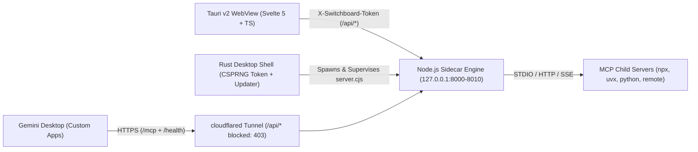

<div align="center">
  
  <h1>MCP Switchboard</h1>
  <p>
    Lightweight desktop MCP multiplexer and Cloudflare HTTPS tunnel console for <strong>Gemini Desktop</strong>, built with <strong>Tauri v2</strong>, <strong>Svelte 5</strong>, strict <strong>TypeScript</strong>, and <strong>Node.js</strong>.
  </p>
  <p>
    <a href="https://github.com/Sury2797/MCP-SWITCHBOARD/releases">
      
    </a>
    
    
    
  </p>
</div>

---

MCP Switchboard combines multiple local (`stdio`) and remote (`streamableHttp` / `sse`) Model Context Protocol servers behind a single Streamable HTTP endpoint (`http://localhost:8000/mcp`) and an optional HTTPS Cloudflare Tunnel (`https://*.trycloudflare.com/mcp` or custom domain). Toggling a server off terminates its child process (`0 MB RAM`) and removes its tool schemas from `tools/list` (`0 input tokens`) via `notifications/tools/list_changed`.

## Architecture



## Features

| Area | Details |
| :--- | :--- |
| **Dynamic Multiplexing** | Paste standard `mcpServers` JSON snippets or use the form editor. Tools are namespaced as `<serverName>__<toolName>` and synced automatically to connected clients. |
| **Token Budget Meter** | Estimates active input token cost (`JSON.stringify(tools).length / 4`) per server and across active tools (`Lean < 3k`, `Moderate 3k–10k`, `High > 10k`). |
| **Rust-Enforced Security** | Per-launch 256-bit OS-CSPRNG session token passed from Rust to sidecar (`401` without token); `/api/*` blocks tunnel/proxy headers (`403`), non-local `Host` headers, untrusted browser `Origin`s, and non-`http(s)` server URLs; strict Tauri `default-src 'self'` CSP. |
| **Zero-Overhead Native UI** | Precision dark/light quiet-graphite console built with Svelte 5 runes, BoardUI-styled primitives (`Button`, `Switch`, `SegmentedControl`, `CustomSelect`), React Bits `CountUp` and `spotlight` catchlight, locked non-bouncing viewport, and `prefers-reduced-motion` support. |
| **Smart Windows Diagnostics** | Reads `HKCU` + `HKLM` Registry `PATH`, expands environment variables, scans installed Python 3.x directories, and resolves `.cmd`/`.exe` shims for `node`, `npx`, `uvx`, `python`, and `cloudflared`. |
| **Auto Process Cleanup** | Parent PID watchdog inside the sidecar plus tree termination (`taskkill /T /F` on Windows, `SIGTERM` → `SIGKILL` on Unix) leaves zero orphaned child processes on exit. |
| **Signed OTA Updates** | Built-in `tauri-plugin-updater` client with Minisign signature verification, release notes, download progress bar, and GitHub Releases integration. |

## Keyboard Shortcuts

| Shortcut | Action |
| :--- | :--- |
| `Ctrl+K` / `Cmd+K` | Open **Add MCP Server** modal |
| `Ctrl+F` / `Cmd+F` or `/` | Focus server search filter |
| `?` | Open **Gemini Desktop Setup & Diagnostics** drawer |
| `Escape` | Close active modal, dropdown, or drawer |

---

## Installing & Connecting to Gemini Desktop

### Requirements
* **Node.js 20+** (required to run the bundled sidecar engine and npm MCP servers):  
  Windows: `winget install OpenJS.NodeJS.LTS` · macOS: `brew install node`
* **cloudflared** *(only needed when exposing `/mcp` over HTTPS)*:  
  Windows: `winget install --id Cloudflare.cloudflared` · macOS: `brew install cloudflared`

### Setup
1. Download and run `MCP Switchboard_<version>_x64-setup.exe` (or `.msi`) from [Releases](https://github.com/Sury2797/MCP-SWITCHBOARD/releases).
   * Per-user installs land in `%LOCALAPPDATA%\Programs\MCP Switchboard\`.
   * User configs persist safely across updates in `%APPDATA%\com.mcpswitchboard.desktop\mcp-switchboard.json`.
2. Toggle the MCP servers you want active, then flip the header **Tunnel Switch ON**.
3. Wait for status **Tunnel live**, then click **Copy URL** (`https://.../mcp`).
4. In **Gemini Desktop**, open **Settings → Connected Apps → Custom apps → Add a custom app**, paste the URL, and save.

---

## Development & Build

### Install Dependencies
```bash
npm install
```
*(Runs `postinstall` automatically to install `sidecar/` dependencies.)*

### Run Native App in Dev Mode
```bash
npm run tauri dev
```
Starts the Vite Svelte 5 frontend on `http://localhost:1420`, opens the Tauri desktop shell, and launches the sidecar on `127.0.0.1:8000` (auto-falling back to `8001`–`8010` if busy).

### Run All Verification Checks
```bash
npm run check                                                   # svelte-check (strict TS) + tsc on sidecar/
node sidecar/test-e2e.mjs                                       # End-to-end MCP routing + 401/403/400 security tests
cargo fmt --manifest-path src-tauri/Cargo.toml --check          # Rust formatting check
cargo clippy --manifest-path src-tauri/Cargo.toml --all-targets --all-features -- -D warnings
```

### Build Optimized Desktop Installers
```bash
npm run tauri build
```
Compiles the single-file bundled sidecar (`sidecar/dist/server.cjs`, ~1.9 MB), builds the Vite UI, and compiles the stripped/LTO Tauri release binary (`~4.8 MB` executable, `~2.27 MiB` NSIS setup, `~3.16 MiB` MSI) into `src-tauri/target/release/bundle/`.

To publish signed OTA updates via [.github/workflows/release.yml](.github/workflows/release.yml), add `TAURI_SIGNING_PRIVATE_KEY` and `TAURI_SIGNING_PRIVATE_KEY_PASSWORD` to GitHub repository secrets, then push a version tag (`git tag v1.0.2 && git push origin v1.0.2`).

---

## Project Structure

```text
mcp-switchboard/
├── .github/workflows/release.yml     # Automated Windows build, signing & latest.json release CI
├── public/app-icon.png               # Desktop & README application icon
├── sidecar/                          # Node.js Express + @modelcontextprotocol/sdk multiplexer
│   ├── server.js                     # /mcp endpoint, /health, token-guarded /api/* & SSE stream
│   ├── test-e2e.mjs                  # Automated security & MCP tool-routing verification suite
│   └── lib/                          # configStore, mcpManager, tunnelManager, processUtils, diagnostics
├── src/                              # Strict TypeScript + Svelte 5 quiet-graphite UI
│   ├── App.svelte                    # Root shell, native desktop guards, SSE sync, updater banner
│   ├── lib/
│   │   ├── api.ts                    # Retry polling discovery, token-authenticated REST & SSE client
│   │   ├── types.ts                  # Canonical shared domain & API types
│   │   ├── updater.ts                # Tauri v2 in-app updater client with progress callbacks
│   │   ├── icons/                    # Streamline SVG icon registry (typed IconName)
│   │   └── primitives/               # Button, CountUp, CustomSelect, SegmentedControl, Switch, spotlight
│   └── components/                   # TopConnectionBar, TelemetryStrip, SwitchboardList, modals & drawers
├── src-tauri/                        # Tauri v2 Rust host shell
│   ├── src/lib.rs                    # CSPRNG token enforcement, sidecar spawn/shutdown, updater plugin
│   ├── tauri.conf.json               # Strict CSP, LTO bundle config, signed updater endpoint
│   └── capabilities/default.json     # Least-privilege main-window Tauri capabilities
├── tsconfig.json                     # Strict TypeScript config for Svelte 5 frontend
└── tsconfig.sidecar.json             # TypeScript checkJs config for Node.js sidecar
```
